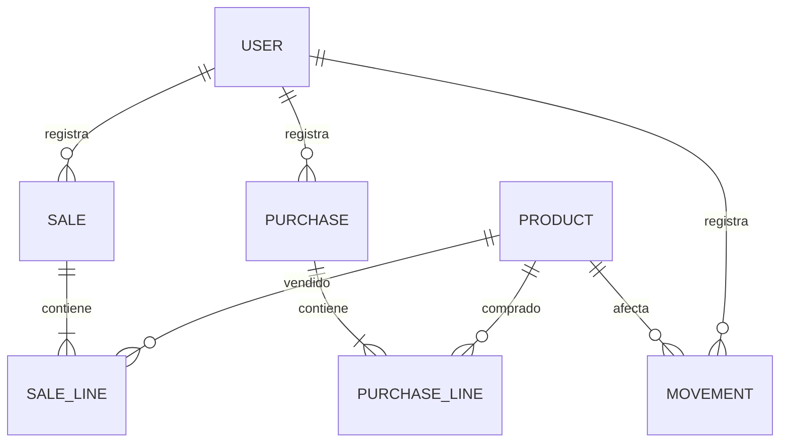

# Base de datos NexusStock

Los modelos e índices se definen en `backend/src/models.js` y se inicializan al arrancar la API. No se necesitan tablas SQL ni importar datos de ejemplo.

| Colección | Contenido | Restricciones principales |
| --- | --- | --- |
| users | Nombre de usuario, identidad, correo de contacto, hash bcrypt, rol, estado y versión de sesión | Usuario único normalizado; correo de contacto único; nunca se devuelve el hash |
| products | Código, precios, impuestos, ganancia, stock disponible, daños y estado | Código único; stock entero no negativo |
| counters | Consecutivos de productos, ventas, compras y daños | Un contador por tipo; incremento transaccional |
| sales | Líneas históricas, descuentos, usuario y totales | requestId y número únicos |
| purchases | Proveedor, costos, impuestos y cantidades | requestId y número únicos |
| movements | Entradas, salidas y daños con responsable y referencia | requestId único para daños; índice por fecha |

Las líneas se embeben en cada operación y guardan nombre, código y precios del momento. Modificar un producto no altera comprobantes históricos. La eliminación de productos es lógica y exige stock disponible cero; los daños acumulados y movimientos se conservan.

**Transacciones:** las operaciones usan `connection.transaction`, escritura majority y decrementos condicionados por existencias. Una compra/venta/daño y sus movimientos se confirman juntos. Las operaciones repetidas con igual requestId y contenido no vuelven a mover inventario. Un requestId reutilizado con otros datos o usuario devuelve 409. No se admiten productos repetidos dentro de la misma operación.

**Precios:** moneda COP y dos decimales. IVA e impuesto adicional se aplican ambos sobre el neto. El porcentaje de ganancia es un recargo sobre el costo, no un margen sobre el precio final. Precio sugerido = redondear(redondear(neto × (1 + (IVA + impuesto)/100)) × (1 + ganancia/100)). Cada compra actualiza costos y precio de venta al sugerido. El valor del inventario usa stock actual × último precio neto; no implementa contabilidad FIFO ni costo promedio. Existe un límite de un billón COP por importe calculado para evitar pérdida de precisión. Los reportes agrupan por America/Bogota.

El contenedor incluido es para desarrollo local y solo publica el puerto en 127.0.0.1. Para producción usa MongoDB Atlas con credenciales propias y TLS o un replica set administrado con autenticación. No expongas este contenedor a Internet.

Consulta [instalación](../docs/INSTALACION.md) para Docker, MongoDB local y Atlas; [respaldo](../docs/OPERACION.md) para copias de seguridad.
