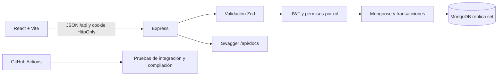

# Arquitectura y decisiones

## Capas

- frontend/src/main.jsx: portada, acceso, rutas, sesión y navegación por rol.
- frontend/src/pages.jsx: operaciones, catálogo, inventario, reportes, historial y administración.
- frontend/src/ui.jsx: formularios, paginación, diálogos nativos y consultas con cancelación lógica de respuestas antiguas.
- frontend/src/api.js: transporte JSON, manejo de sesión vencida y cálculos de vista previa.
- backend/src/app.js: rutas REST, validación, consultas, transacciones y errores JSON.
- backend/src/models.js: modelos, índices, secuencias y relaciones.
- backend/src/auth.js: firma/verificación JWT, cookie y control de roles.
- backend/src/domain.js: reglas de cálculo compartidas dentro del servidor.
- backend/src/validation.js: contratos estrictos y límites de entradas.
- backend/src/openapi.js: contrato OpenAPI 3.0.3 servido por Swagger.

## Seguridad implementada

Las contraseñas se cifran con bcrypt (costo 12) y se limita la entrada a 72 bytes, evitando el truncamiento de bcrypt. Los JWT vencen en ocho horas, fijan algoritmo HS256, emisor y audiencia, y se entregan en cookies HttpOnly, SameSite=Strict y Secure en producción. No se guardan en localStorage. Cada petición consulta rol y estado actuales y verifica tokenVersion, de modo que cambiar permisos o cerrar sesión revoca sesiones anteriores.

Las autorizaciones se aplican en cada ruta del servidor. Ocultar botones en React sirve como guía, pero no concede permisos. El registro público fija vendedor y rechaza campos adicionales; crear administradores requiere un administrador existente. El comando seed crea el primer administrador con credenciales propias. Se bloquea la modificación de la propia cuenta para impedir eliminar al último administrador mediante esta interfaz.

Los esquemas Zod rechazan claves inesperadas, identificadores inválidos, precios con más de dos decimales, cantidades fraccionarias, descuentos fuera de rango y líneas repetidas. La API no acepta totales ni precios de venta enviados por clientes al confirmar una venta. Las búsquedas escapan caracteres de expresiones regulares. No se pasan cuerpos de petición directamente como filtros MongoDB.

Se incluyen Helmet, CORS limitado a los orígenes configurados, comprobación del Origin en escrituras, cookies SameSite, límites globales y específicos de autenticación, cuerpos JSON de tamaño limitado y respuestas de error sin trazas ni secretos. Swagger elimina el CSP solo en su ruta para permitir sus recursos; el resto mantiene Helmet. Las respuestas de API no se almacenan en caché.

## Consistencia

Las operaciones comerciales actualizan inventario, comprobantes, movimientos y consecutivos en la misma transacción. Los descuentos se redondean por línea y luego se aplica el descuento general. Los decrementos incluyen stock >= cantidad y solo afectan productos activos. Un conflicto de escritura se reintenta según el controlador MongoDB; la condición de stock se vuelve a evaluar. No se procesa una venta parcialmente.

requestId UUID más una huella del contenido permite reintentar la misma compra/venta sin duplicarla. El identificador solo se puede reutilizar con el mismo usuario y contenido. Los daños también tienen identificador y validación de contenido. En conflictos simultáneos de identificadores únicos se puede devolver 409; reintentar el mismo contenido permite recuperar una operación ya confirmada.

El estado de carrito vive en memoria de la pestaña. No hay operación offline ni sincronización de carritos entre dispositivos. Las gráficas consultan datos persistidos; no incluyen valores ficticios. La consulta del panel se actualiza al abrirlo o cambiar año; no hay notificaciones push.

## Límites conocidos

Se implementa un negocio y moneda COP. El cálculo tributario es configurable por producto y no es un motor fiscal. El inventario se valora al último neto. El historial es de solo lectura. Los precios usan Number y redondeo a dos decimales, con límites operativos; para un libro contable o múltiples monedas conviene migrar a unidades menores enteras/Decimal128. El contador respeta consecutivos transaccionales, pero un producto archivado conserva su número y no se reutiliza.

El historial de movimientos permite auditar stock, pero no constituye una auditoría externa inmutable de todas las acciones administrativas. Recuperación de contraseñas por correo, MFA, facturación fiscal e integración de pagos quedan fuera de las funcionalidades solicitadas. El administrador puede activar/desactivar cuentas; no hay envío de correo.

La recuperación exige una habilitación administrativa vigente durante quince minutos y las credenciales actuales de un administrador activo, introducidas personalmente en el formulario. No se emiten códigos. El servidor valida el rol y la contraseña, consume la habilitación atómicamente y revoca las sesiones de la cuenta recuperada. Cambiar usuario, permisos o estado, y revocar, invalidan la autorización. Otro administrador gestiona la recuperación de una cuenta administradora. El acceso y la recuperación usan username; email es solo contacto. Las cuentas anteriores reciben nombres únicos mediante una migración idempotente que conserva contraseñas y roles. Detalles y rutas en RECUPERACION.md.
