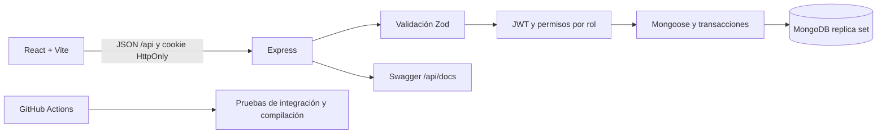

# Arquitectura y decisiones



## Modelo, vista y controlador (MVC)

La aplicación usa MVC adaptado a una API REST y una interfaz React. Express recibe las solicitudes, aplica permisos en las rutas y delega en controladores. Los modelos Mongoose mantienen los datos y sus índices. React constituye la vista; sus controladores son hooks que gestionan el estado y los eventos sin generar HTML.

```text
backend/src/
  app.js                       Configuración de Express y montaje de rutas
  server.js                    Conexión a MongoDB e inicio del servidor
  routes/index.js              Métodos, direcciones y permisos de cada endpoint
  controlador/
    authController.js          Registro, acceso, recuperación y cierre de sesión
    usersController.js         Usuarios y autorizaciones administrativas
    productsController.js      Catálogo, inventario y daños
    operationsController.js    Compras, ventas e historiales
    reportsController.js       Estadísticas mensuales
    systemController.js        Estado del servicio y contrato OpenAPI
  modelo/
    User.js                    Usuario y seguridad de la cuenta
    Product.js                 Producto y existencias
    Sale.js                    Venta y sus líneas
    Purchase.js                Compra y sus líneas
    Movement.js                Movimiento de inventario
    Counter.js                 Consecutivos
    fields.js                  Campos y subesquemas compartidos
    index.js                   Inicialización y exportación de modelos
  middleware/                  JWT, permisos, límites y manejo de errores
  services/operations.js        Transacciones y utilidades comunes
  domain.js                    Cálculos comerciales del servidor
  validation.js                Contratos de entrada Zod
  openapi.js                   Documentación Swagger

frontend/src/
  main.jsx                     Entrada de React y estilos
  App.jsx                      Rutas y composición de la aplicación
  modelo/
    api.js                     Transporte JSON y cálculos de vista previa
    session.js                 Contexto de la sesión actual
  controlador/
    sessionController.js       Inicio, carga y cierre de sesión; navegación
    resourceController.js      Consultas, búsqueda e identificadores de solicitud
    dashboardController.js     Estadísticas del panel
    productsController.js      Edición de la ficha de producto
    inventoryController.js     Productos, daños y movimientos
    operationsController.js    Carritos y registro de compras/ventas
    historyController.js       Consulta de comprobantes
    usersController.js         Cuentas, roles y estado
    recoveryController.js      Recuperación y habilitación administrativa
  vista/
    pages/                     Portada, acceso y pantallas de cada módulo
    components/                Logo, protección de rutas y elementos reutilizables
    layouts/Shell.jsx          Menú, cuenta y botón Cerrar sesión
```

Los puntos de entrada importan directamente los módulos MVC; se eliminaron los archivos de compatibilidad que solo reexportaban código. Los nombres de las colecciones se conservan y no se borra la base de datos.

Para agregar una función, define el modelo o sus campos en `modelo/`, implementa el controlador del servidor y registra la ruta con su permiso. Agrega el hook de interacción en `frontend/src/controlador/` y presenta sus datos en `frontend/src/vista/`. Los cálculos del navegador son orientativos: el servidor vuelve a validarlos antes de guardar.

## Seguridad implementada

Las nuevas contraseñas tienen entre 4 y 12 caracteres y se cifran con bcrypt (costo 12), sin reglas de complejidad. El acceso conserva compatibilidad con contraseñas anteriores de hasta 72 bytes. Los JWT vencen en ocho horas, fijan algoritmo HS256, emisor y audiencia, y se entregan en cookies HttpOnly, SameSite=Strict y Secure en producción. No se guardan en localStorage. Cada petición consulta rol y estado actuales y verifica tokenVersion, de modo que cambiar permisos o cerrar sesión revoca sesiones anteriores.

Las autorizaciones se aplican en cada ruta del servidor. Ocultar botones en React sirve como guía, pero no concede permisos. El registro público fija vendedor y rechaza campos adicionales; crear administradores requiere un administrador existente. El comando seed crea el primer administrador con credenciales propias. Se bloquea la modificación de la propia cuenta para impedir eliminar al último administrador mediante esta interfaz.

Los esquemas Zod rechazan claves inesperadas, identificadores inválidos, precios con más de dos decimales, cantidades fraccionarias, descuentos fuera de rango y líneas repetidas. La API no acepta totales ni precios de venta enviados por clientes al confirmar una venta. Las búsquedas escapan caracteres de expresiones regulares. No se pasan cuerpos de petición directamente como filtros MongoDB.

Se incluyen Helmet, CORS limitado a los orígenes configurados, comprobación del Origin en escrituras, cookies SameSite, límites globales y específicos de autenticación, cuerpos JSON de tamaño limitado y respuestas de error sin trazas ni secretos. Swagger elimina el CSP solo en su ruta para permitir sus recursos; el resto mantiene Helmet. Las respuestas de API no se almacenan en caché.

## Consistencia

Las operaciones comerciales actualizan inventario, comprobantes, movimientos y consecutivos en la misma transacción. Los descuentos se redondean por línea y luego se aplica el descuento general. Los decrementos incluyen stock >= cantidad y solo afectan productos activos. Un conflicto de escritura se reintenta según el controlador MongoDB; la condición de stock se vuelve a evaluar. No se procesa una venta parcialmente.

requestId UUID más una huella del contenido permite reintentar la misma compra/venta sin duplicarla. El identificador solo se puede reutilizar con el mismo usuario y contenido. Los daños también tienen identificador y validación de contenido. En conflictos simultáneos de identificadores únicos se puede devolver 409; reintentar el mismo contenido permite recuperar una operación ya confirmada.

El estado de carrito vive en memoria de la pestaña. No hay operación offline ni sincronización de carritos entre dispositivos. Las gráficas consultan datos persistidos; no incluyen valores ficticios. La consulta del panel se actualiza al abrirlo o cambiar año; no hay notificaciones push.

## Límites conocidos

Se implementa un negocio y moneda COP. El cálculo tributario es configurable por producto y no es un motor fiscal. El inventario se valora al último neto. El historial es de solo lectura. Los precios usan Number y redondeo a dos decimales, con límites operativos; para un libro contable o múltiples monedas conviene migrar a unidades menores enteras/Decimal128. El contador respeta consecutivos transaccionales, pero un producto archivado conserva su número y no se reutiliza.

El historial de movimientos permite auditar stock, pero no constituye una auditoría externa inmutable de todas las acciones administrativas. Recuperación de contraseñas por correo, MFA, facturación fiscal e integración de pagos quedan fuera de las funcionalidades solicitadas. El administrador puede activar/desactivar cuentas; no hay envío de correo.

La recuperación requiere una solicitud vinculada al navegador por cookie HttpOnly y autorización administrativa sin vencimiento. No pide credenciales administrativas ni códigos. El servidor consume la autorización de forma atómica y revoca sesiones. Cambios de cuenta/permisos o revocación invalidan la autorización. Consulta RECUPERACION.md.
